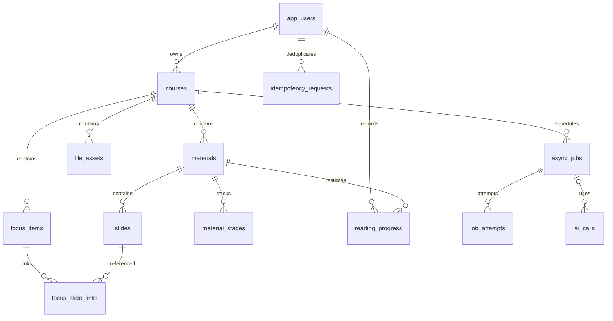

# 首轮数据库设计

日期：2026 年 10 月 27 日。覆盖 PB01 至 PB08 和首轮 PB20，共 13 张规划表；本次没有创建数据库、DDL 或迁移脚本。字段和接口应在初始化前同步核对。

## 1 命名和通用约定

- 使用 MySQL 8.4、InnoDB、utf8mb4。业务主键使用后端生成的 UUID，SQL 类型为 `CHAR(36)`，标识列使用相同的字符集与二进制比较规则。
- 所有表有 `created_at`，可修改实体另有 `updated_at`；时间用 UTC `DATETIME(3)`，API 输出带 `Z` 的 ISO 8601 字符串。
- `row_version BIGINT` 用于乐观锁，更新携带 expectedVersion，服务端按当前版本条件更新，成功加一。业务来源修订与行版本分别维护。
- 枚举用受限字符串和迁移约束表示，不用多个互相矛盾的布尔字段；JSON 只保存任务参数、快照等非主要查询结构。
- 归属链为用户 → 课程 → 课件或重点。冗余 owner_id 仅用于任务领取或查询，写入时与课程核对，不接受客户端指定。
- 业务外键默认 RESTRICT。程序负责显式删除顺序和外部文件清理，不用数据库级联代替生命周期逻辑；约束行为依据[MySQL 外键说明](https://dev.mysql.com/doc/refman/8.4/en/create-table-foreign-keys.html)实现。

## 2 关系概览

图中省略资产到原件、预览和缩略图的多条引用，具体字段如下。任务 target_id 和幂等 resource_id 为多态业务标识，不创建指向多张表的伪外键；通过服务层校验存在性和归属。

## 3 用户和课程

### app_users

| 字段 | 类型与约束 | 含义 |
| --- | --- | --- |
| id | CHAR(36)，主键 | 用户标识 |
| username | VARCHAR(32)，非空 | 用户输入的账号显示形式 |
| username_norm | VARCHAR(32)，非空、唯一 | 规范化账号，首期 ASCII 字母数字及下划线，忽略大小写 |
| password_hash | VARCHAR(255)，非空 | 带算法标识的单向哈希，不存密码原文 |
| display_name | VARCHAR(50)，非空 | 初值可为用户名 |
| status | VARCHAR(16)，非空 | ACTIVE 或 DISABLED |
| row_version | BIGINT，非空 | 行版本 |

账号长度设计为 3 至 32。密码计划为 8 至 64 个字符，初始化时按选定编码器再施加字节边界并同步前端提示；本次不承诺可接受所有超长 Unicode 输入。

### courses

| 字段 | 类型与约束 | 含义 |
| --- | --- | --- |
| id、owner_id | CHAR(36)，主键及用户外键 | 课程与所有者 |
| name | VARCHAR(100)，非空 | 去除首尾空白后 1 至 100 字符；不要求同名唯一 |
| remark | VARCHAR(1000)，可空 | 课程备注 |
| status | VARCHAR(16)，非空 | ACTIVE、DELETING、DELETED |
| lifecycle_version | BIGINT，非空 | 删除时递增，阻止旧任务发布 |
| row_version | BIGINT，非空 | 元数据编辑版本 |
| deleted_at | DATETIME(3)，可空 | 用户确认删除的时间 |

索引：`(owner_id, status, updated_at, id)`。首页按课程元数据 updated_at 倒序、id 倒序稳定排序，普通阅读不持续修改课程排序时间。

## 4 文件、课件与页面

### file_assets

| 字段 | 类型与约束 | 含义 |
| --- | --- | --- |
| id、course_id | CHAR(36)，主键及课程外键 | 资产与归属课程 |
| kind | VARCHAR(24)，非空 | ORIGINAL、CONVERTED_PDF、PAGE_IMAGE、THUMBNAIL |
| storage_key | VARCHAR(255)，非空、唯一 | 根目录内相对键，由系统生成，不是客户端路径 |
| original_name | VARCHAR(255)，可空 | 原文件显示名，下载时安全编码 |
| media_type | VARCHAR(100)，非空 | 经内容校验后确定的类型 |
| size_bytes | BIGINT，非空 | 字节数，非负 |
| sha256 | CHAR(64)，非空 | 校验和，不作为跨用户去重和可见性依据 |
| status | VARCHAR(24)，非空 | READY、DELETE_PENDING、DELETED |
| deleted_at | DATETIME(3)，可空 | 逻辑删除时间 |

索引：`(course_id, status)`。文件先在任务或上传临时目录完整生成，再登记 READY；不存在“数据库说文件成功、实际还在写”的公开资产。未登记残留由孤立文件清理处理。

### materials

| 字段 | 类型与约束 | 含义 |
| --- | --- | --- |
| id、course_id | CHAR(36)，主键及课程外键 | 课件与课程 |
| original_asset_id | CHAR(36)，资产外键，可空 | ACTIVE 时必须有原件；清理后置空 |
| display_name | VARCHAR(255)，非空 | 课件显示名，初值为原文件名 |
| status | VARCHAR(16)，非空 | ACTIVE、DELETING、DELETED |
| content_version | INT，非空 | 原件内容版本，首期固定为 1，不支持原地换文件 |
| lifecycle_version | BIGINT，非空 | 删除时递增 |
| slide_count | INT，可空 | 真实 PPT 页数，提取前未知，已知时大于 0 |
| mapping_status | VARCHAR(16)，非空 | PENDING、VERIFIED、FAILED，表示当前对外可用预览的映射；无可用结果时表示首次映射状态 |
| converted_pdf_asset_id | CHAR(36)，资产外键，可空 | 最近成功且可用的转换 PDF |
| row_version、deleted_at | 行版本、时间 | 编辑与删除控制 |

索引：`(course_id, status, created_at, id)`。课件列表进度从阶段表聚合，不能只靠一个 processing 布尔值表示全部能力。新预览尝试失败不抹去旧预览的 VERIFIED 映射，失败原因记录在阶段与执行尝试中；没有旧成功结果时才将映射标记 FAILED。

### slides

| 字段 | 类型与约束 | 含义 |
| --- | --- | --- |
| id、material_id | CHAR(36)，主键及课件外键 | 稳定页面标识 |
| page_no | INT，非空 | 原始 PPT 页序，从 1 开始 |
| is_hidden | BOOLEAN，非空 | 记录原始隐藏属性，不因此重新编号 |
| title | VARCHAR(255)，可空 | 提取标题，不能保证每页都有 |
| text_content | LONGTEXT，可空 | 本页提取文字，无文字用空串，尚未提取才是 NULL |
| text_revision | INT，可空 | 本页已发布文本修订 |
| preview_asset_id、thumbnail_asset_id | CHAR(36)，资产外键，可空 | 已发布的图片与缩略图 |
| pdf_page_no | INT，可空 | 经核对的 PDF 页号，不能替代 page_no |
| deleted_at | DATETIME(3)，可空 | 原课件删除后标记 |

唯一键：`(material_id, page_no)`。重试按此键更新，不能重新生成 slideId 导致关联失效。首期文字与预览均以整阶段发布，暂存结果不通过此表对用户公开。

### material_stages

| 字段 | 类型与约束 | 含义 |
| --- | --- | --- |
| id、material_id | CHAR(36)，主键及课件外键 | 阶段记录 |
| stage | VARCHAR(24)，非空 | TEXT、PREVIEW、INDEX、QUESTION_GENERATION |
| status | VARCHAR(24)，非空 | NOT_STARTED、QUEUED、RUNNING、SUCCEEDED、FAILED、CANCELLED、NOT_APPLICABLE |
| requested_revision | INT，非空 | 最新请求修订，创建或重试时递增 |
| published_revision | INT，可空 | 最近完整成功发布的修订，没有成功结果则为空 |
| input_text_revision | INT，可空 | INDEX 或出题所用的文本修订 |
| last_job_id | CHAR(36)，任务外键，可空 | 最近任务 |
| error_code、error_message | VARCHAR(64)、VARCHAR(500)，可空 | 可向用户展示的安全错误 |
| updated_at | DATETIME(3)，非空 | 最近阶段状态变更 |

唯一键：`(material_id, stage)`。首轮出题阶段为 NOT_APPLICABLE，前端显示未提供此能力，不能显示为出题成功。重试失败时保留同一原件的旧成功结果，API 分别返回 status 和 available；索引只有基于当前已发布文字才可用。

### reading_progress

| 字段 | 类型与约束 | 含义 |
| --- | --- | --- |
| id、user_id、material_id | CHAR(36)，主键及外键 | 阅读位置归属 |
| last_page_no | INT，非空 | 有效的原始页码 |
| updated_at | DATETIME(3)，非空 | 服务端最后接收时间 |

唯一键：`(user_id, material_id)`。查询与写入均验证该用户拥有课程；多端以最后一次服务端成功保存为准。首期不合并多端阅读事件，不据此计算重点掌握。

## 5 重点与页面关联

### focus_items

| 字段 | 类型与约束 | 含义 |
| --- | --- | --- |
| id、course_id | CHAR(36)，主键及课程外键 | 重点与课程 |
| content | VARCHAR(2000)，非空 | 去除首尾空白后的重点文本 |
| original_input | TEXT，可空 | 多条拆分时的原始输入，按课程权限保护 |
| content_revision | INT，非空 | 仅正文或影响定位的内容变化时递增 |
| mastery_status | VARCHAR(24)，非空 | NOT_STARTED、IN_PROGRESS、UNFAMILIAR、MASTERED |
| match_status | VARCHAR(24)，非空 | NEVER、RUNNING、MATCHED、NO_MATCH、NEEDS_REVIEW、FAILED |
| last_locate_job_id | CHAR(36)，任务外键，可空 | 最近定位任务 |
| row_version | BIGINT，非空 | 所有编辑的并发控制版本 |
| deleted_at | DATETIME(3)，可空 | 删除后业务不可见，保留后续来源摘要能力 |

索引：`(course_id, deleted_at, created_at, id)`。改变掌握状态不增加 content_revision；改正文将 match_status 置为 NEEDS_REVIEW，并使旧任务失去发布资格。MATCHED 表示有候选或有效关联，不表示学生已掌握。

### focus_slide_links

| 字段 | 类型与约束 | 含义 |
| --- | --- | --- |
| id、focus_id、slide_id | CHAR(36)，主键及外键 | 一个重点与一页的关联 |
| origin | VARCHAR(16)，非空 | AUTO 或 MANUAL |
| decision | VARCHAR(16)，非空 | CANDIDATE、CONFIRMED、REJECTED |
| matched_focus_revision | INT，非空 | 该关联对应的重点正文修订 |
| locate_job_id | CHAR(36)，任务外键，可空 | 自动候选来自哪次任务 |
| evidence_text | VARCHAR(1000)，可空 | 裁剪后的来源片段 |
| reason | VARCHAR(500)，可空 | 匹配依据或人工说明，不是可信度百分比 |
| source_snapshot | JSON，非空 | 课件名、原页码、标题等必要摘要 |
| row_version | BIGINT，非空 | 关联修改版本 |

唯一键：`(focus_id, slide_id)`；索引：`(focus_id, decision)`、`(slide_id)`。必须在同一用户同一课程内关联。新的自动定位只刷新未受人工干预的候选，不覆盖 CONFIRMED、REJECTED 或 MANUAL。正文修订不一致时返回 needsReview，学生可重新确认或排除。

## 6 任务、调用与幂等

### async_jobs

| 字段 | 类型与约束 | 含义 |
| --- | --- | --- |
| id、owner_id、course_id | CHAR(36)，主键及外键 | 任务归属 |
| type | VARCHAR(32)，非空 | TEXT_EXTRACT、PREVIEW_RENDER、INDEX_BUILD、FOCUS_LOCATE、MATERIAL_PURGE、COURSE_PURGE |
| target_id、dedup_key | CHAR(36)、VARCHAR(191)，非空 | 目标与唯一业务任务键 |
| input_snapshot | JSON，非空 | 来源版本、阶段修订、课程和课件生命周期；不含 Key |
| status | VARCHAR(24)，非空 | QUEUED、RUNNING、SUCCEEDED、FAILED、CANCELLED |
| attempt_count、max_attempts | INT，非空 | 当前尝试数与上限，初值上限 3 |
| run_after | DATETIME(3)，非空 | 最早可领取时间，含退避 |
| lease_token | CHAR(36)，可空 | 当前领取令牌，用于发布防护 |
| lease_until、heartbeat_at | DATETIME(3)，可空 | 租约及心跳 |
| progress_done、progress_total | INT，可空 | 已知单位计数，未知不假报百分比 |
| result_summary | JSON，可空 | 安全结果摘要，不存大段完整课件 |
| error_code、error_message | 安全错误字段，可空 | 本次最终错误 |

唯一键：`dedup_key`；领取索引：`(status, run_after, created_at)`。任务键包含目标、类型、内容版本或阶段修订。重试创建新的请求修订与任务键；同一请求键不重复建任务。发布前核对 requested_revision，旧任务不得覆盖新任务。

### job_attempts

| 字段 | 类型与约束 | 含义 |
| --- | --- | --- |
| id、job_id | CHAR(36)，主键及任务外键 | 一次实际执行 |
| attempt_no | INT，非空 | 第几次尝试 |
| lease_token | CHAR(36)，非空 | 对应租约 |
| started_at、finished_at | DATETIME(3)，后者可空 | 实际时间 |
| outcome | VARCHAR(24)，非空 | RUNNING、SUCCEEDED、FAILED、LEASE_LOST、CANCELLED |
| error_code、safe_log_summary | 安全错误与摘要，可空 | 诊断数据，不含凭据或完整正文 |

唯一键：`(job_id, attempt_no)`。旧工作者即使晚返回也只能记录自身尝试失败，不能把新工作者的任务状态改回去。

### ai_calls

| 字段 | 类型与约束 | 含义 |
| --- | --- | --- |
| id、owner_id、course_id | CHAR(36)，主键及外键 | 调用及所属范围 |
| job_id | CHAR(36)，任务外键，可空 | 同步拆分预览时可为空 |
| scene、model、prompt_version | VARCHAR(32)、VARCHAR(100)、VARCHAR(32) | 场景、实际模型和提示词版本 |
| request_fingerprint | CHAR(64)，非空 | 对必要输入计算摘要，不保存密钥 |
| quota_date | DATE，非空 | 按 Asia/Shanghai 归属的每日调用配额日期 |
| status | VARCHAR(24)，非空 | RESERVED、SENDING、SUCCEEDED、FAILED、UNKNOWN |
| input_tokens、output_tokens | BIGINT，可空 | 服务商实际返回的用量，未知是 NULL，不写 0 |
| duration_ms、provider_request_id | BIGINT、VARCHAR(255)，可空 | 耗时和可获得的服务商追踪号 |
| error_code | VARCHAR(64)，可空 | 外部错误映射 |

索引：`(owner_id, quota_date, status)`。配额预占采用短事务锁定该用户行后计数和登记，防止并发绕过限制；首期按本日所有已登记调用尝试计入次数限制，包括失败和 UNKNOWN，避免超时后无限重试。尚无配置额度时不实际发起付费调用。预算金额和计费核算留待具体预算确定。

### idempotency_requests

| 字段 | 类型与约束 | 含义 |
| --- | --- | --- |
| id、owner_id | CHAR(36)，主键及用户外键 | 已登录写请求的幂等记录 |
| operation、resource_id | VARCHAR(64)、CHAR(36)，非空 | 操作与作用范围，创建课程使用当前用户标识作为范围 |
| request_key | VARCHAR(128)，非空 | 客户端生成的 Idempotency-Key |
| request_hash | CHAR(64)，非空 | 规范化请求摘要；上传包含文件校验和 |
| status | VARCHAR(16)，非空 | PROCESSING、COMPLETED |
| response_status、response_body | INT、JSON，可空 | 可安全重放的结果，排除凭据 |
| resource_ids | JSON，可空 | 已创建的业务与任务标识，便于失败恢复 |
| expires_at | DATETIME(3)，非空 | 初值保留至少 24 小时，删除与清理另行覆盖 |

唯一键：`(owner_id, operation, resource_id, request_key)`。相同键不同请求体返回 409；进行中重复请求返回明确处理中状态，不额外触发付费工作。过期 PROCESSING 不能直接当作新请求：先按资源标识对账再完成或清理。

## 7 核心事务

| 操作 | 短事务内的原子变化 | 事务外工作 |
| --- | --- | --- |
| 创建课程与重点 | 归属检查、幂等键、实体和响应结果 | 输入展示 |
| 上传登记 | 原件资产、课件、阶段行、初始任务和幂等结果 | 校验、临时写盘、最终移动及失败补偿 |
| 阶段发布 | 检查租约和生命周期，更新稳定页面、阶段修订及下一任务 | POI、转换、渲染和索引写入 |
| 定位发布 | 校验重点正文修订，只更新允许替换的候选，更新 match_status | 检索和外部 AI 调用 |
| 课程或课件删除 | 生命周期递增、禁止业务访问、取消普通任务、登记清理任务 | 删除文件、清理索引和后续物理清理 |

发布事务按课程 → 课件或重点 → 阶段的顺序获取必要锁，删除采用同一顺序。允许持续重试的请求不能长时间占据数据库事务。Lucene、文件系统和 MySQL 不是跨介质原子事务，依靠版本检查、可重建索引和清理对账处理崩溃窗口。

## 8 删除与恢复

### 删除课件

先把课件标记 DELETING、递增 lifecycle_version，拒绝新访问和普通任务发布。取消关联处理中任务，预览与原件资产标为 DELETE_PENDING。清理索引后删除原件、PDF 和页面图片，清空页面正文及资产引用，保留课件和页面最小来源壳、已有关联摘要，最终标为 DELETED。

课程重点保留，删除课件涉及的候选标识为来源不可用；首期通过联查课件状态计算，不再伪装成有效匹配。阅读位置可以清理。后续笔记、题目和作答按相同来源摘要契约保留。

### 删除课程

用户确认后课程进入 DELETING，所有学习数据立即对业务不可见。清理任务独立获得维护权限，按依赖顺序删除本课程学习记录、正文、文件和索引；不能因“普通任务必须课程 ACTIVE”的规则把清理任务也阻断。

最终仅保留阻止旧任务回写所需的课程技术墓碑及脱敏的最小任务审计，课程名和备注清空或替换为删除标记，不保留题目、笔记等学习内容。幂等响应一并清理，不能重放出已删数据。没有恢复入口；物理清理失败继续维护重试，用户访问仍被拒绝。

## 9 分阶段迁移和后续扩展

计划先实现用户、课程及其约束，再按任务、幂等、课件、重点和 AI 接入分批引入其他表。课程异步删除接口开放前必须已有任务和幂等存储，不能只实现返回 202 却没有清理任务。迁移只前进，已合并的迁移不直接改写；使用新迁移修正。尚未生成 SQL，不假定所有 MySQL 约束已经执行。

Sprint 2 再设计 notes 与来源关联、questions 与不可变版本、练习及作答快照、错题与收藏、对话及消息引用。它们复用课程和稳定 slideId，题目来源不是分建三个题库；历史作答必须保存当时版本，不能只指向可变题干。
