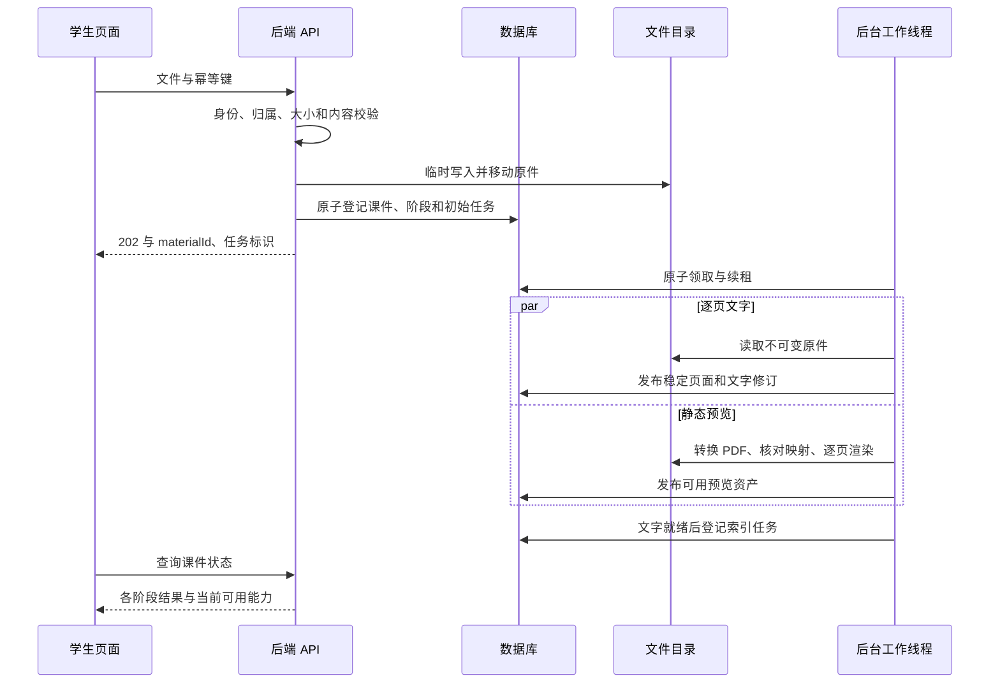

# 课件处理与失败恢复流程

日期：2026 年 10 月 27 日。本文约定上传、提取、预览、索引和重点定位的流程；所有流程待实现，技术验证均未执行。

## 1 不可变原件与稳定页码

每次明确的新上传创建独立课件，原件内容版本固定，不原地覆盖。同一请求重复提交通过幂等键返回原结果。页面顺序来自 PPT 演示文稿的有序幻灯片关系，不按 ZIP 内文件名的字典序排列。

原 PPT 页号、内部 slideId 和转换后的 PDF 页号分别保存。隐藏页保留原页号。提取或渲染重试按 `(materialId, pageNo)` 更新，不能重建全部 slideId。

## 2 上传与处理时序

预览任务不要求文字提取成功，但必须能确认原始页数与页序；两条分支通过同一稳定页面登记逻辑协作。首次建立页面结构时使用事务和唯一键防止并发重复插入，不让分支各自创建不同页面身份。

## 3 上传接受条件

首期开放 PPTX。单文件初始上限 20 MiB，前后端一致，multipart 总请求上限略高于文件限制。校验扩展名、实际 ZIP/OOXML 内容、页数、条目数、解压体积和路径；拒绝压缩炸弹、路径穿越、伪扩展名、空演示文稿和损坏文件。

临时文件使用服务端生成标识，禁止原文件名决定目录。上传字节流与解压各有限额，不把文件一次性全部读入内存。原始文件落盘成功后才登记 READY 资产。

文件移动与数据库提交不能构成同一事务。数据库失败时尽力删除已移动文件；进程崩溃留下的孤立文件通过受控对账清理。清理只处理位于配置根目录内、超过保留时间且确实未被引用的资源，不扫描删除其他目录。

## 4 TEXT 文字阶段

使用 POI 按实际页序遍历文字、文本框、表格和组合形状，形成逐页结构。保留标题、原页号和隐藏属性，适当合并文本块；阅读顺序可能需校正，不能声称提取顺序总等于视觉阅读顺序。提取本页可见文字，首期不把讲者备注混作可见课件内容。

图片里的文字、复杂公式及嵌入对象可能没有可提取内容。记录空页和提取警告，不用 AI 编造缺失文字。整份无可提取文字时 TEXT 失败为 NO_EXTRACTABLE_TEXT，PREVIEW 仍可独立完成，学生可阅读但文字定位不可用。

结果在任务工作目录暂存，发布前核对总页数和源版本。在一个短事务中更新稳定页面及文本修订，并将 TEXT 标为 SUCCEEDED，再登记 INDEX 任务。空文字页依然存在，不能删除后重排页号。

## 5 PREVIEW 预览阶段

每个执行尝试使用独立工作目录及 LibreOffice 用户配置目录，通过参数数组调用转换程序，不拼接可执行 shell 字符串。headless、输出目录和 UserInstallation 参数按[官方启动说明](https://help.libreoffice.org/latest/en-US/text/shared/guide/start_parameters.html)设置，避免复用学生正在使用的桌面实例。

PDF 导出显式设置 `ExportHiddenSlides=true`，不导出备注页；该隐藏页选项的官方默认值为 false，因此不能依赖默认设置。[PDF 导出参数](https://help.libreoffice.org/latest/en-US/text/shared/guide/pdf_params.html)

校验原始页数、PDF 页数与顺序，包含隐藏页、空白页、图片页和重复内容页。页数相等只是必要条件，TV03 还需用页号标记样本和代表性真实课件核对顺序。能够可靠提取 PDF 文本的页面可对比标题或独特短句作为锚点，证据冲突时停止发布；纯图片和重复内容页不能靠这种方法证明顺序，需要结合已验证的导出路径与样本核对，不声称文字校验等于像素保真。

未通过映射校验时不发布新预览：若没有旧成功预览，mappingStatus=FAILED；若同一不可变原件已有 VERIFIED 预览，保留旧资产和映射，仅把本次 PREVIEW 尝试标为失败。VERIFIED 表示通过所定义的来源映射检查，不代表已人工核对每个图像细节。

映射通过后用 PDFBox 顺序渲染页面图和缩略图。单份 PDF 文档由单线程访问，图片逐页落盘后释放，不把所有高分辨率页面保留在列表中；分辨率和资源上限通过长课件验证。[PDFBox 线程与内存说明](https://pdfbox.apache.org/3.0/faq.html)

转换子进程有明确超时、退出码和安全日志；超时终止本任务启动的进程及必要子进程，不按程序名批量终止用户进程。部分渲染结果留在尝试目录，失败时不作为正式资产发布。

完整结果经归属、源版本、租约和映射校验后登记资产，在短事务中更新页面预览字段及阶段成功修订。删除或旧尝试丢失发布资格时清理自身暂存文件。

## 6 INDEX 索引阶段

每个 Lucene 文档以稳定 slideId 为键，包含 ownerId、courseId、materialId、原 pageNo、textRevision、标题和文本。按中文与混合文本分析，支持关键词候选；不引入向量检索作为首期依赖。

只有 TEXT 已发布后才能构建。先完成索引更新和提交，再以条件事务登记对应 inputTextRevision 已发布；读取时过滤当前课程和有效版本。崩溃造成索引已更新但数据库未确认时可重复构建；数据库已确认而索引损坏时标为不可用并重建，不返回旧数据冒充成功。

查询后回查数据库，删除课件、失效来源和无权页面不能泄漏，即使物理索引尚未清除。新文字修订发布后，旧索引与当前版本不一致则暂不开放该课件定位，直到重新构建完成。

## 7 阶段状态与可用性

| 状态 | 含义 | 前端处理 |
| --- | --- | --- |
| NOT_STARTED | 依赖未满足或尚未调度 | 展示等待原因 |
| QUEUED | 已登记待执行 | 可查询，不重复触发 |
| RUNNING | 已领取并有有效租约 | 已知单位时展示计数，否则展示处理中 |
| SUCCEEDED | 本次请求修订完整发布 | 启用对应能力 |
| FAILED | 尝试上限或不可恢复错误 | 说明错误和是否允许新请求重试 |
| CANCELLED | 删除、来源变化或失去发布资格 | 不继续调用，不覆盖新结果 |
| NOT_APPLICABLE | 当前版本未提供该阶段 | 首轮课件出题使用此状态 |

available 与 status 分开：同一原件预览重试失败时，旧成功预览可继续使用；TEXT、INDEX 的版本不一致时，不能沿用旧索引为“可用”。课件删除后所有能力均不可用。全局“部分可用”是前端根据这些字段展示的摘要，不再建立另一套可冲突的持久状态。

## 8 重试和发布防护

- 领取：通过原子条件更新从 QUEUED 到 RUNNING，增加 attempt_count，生成 lease_token。
- 执行：定时续租；转换、提取和网络调用放在数据库事务外。
- 发布：按固定锁顺序检查课程和课件 ACTIVE、生命周期匹配、任务仍持有租约、阶段 requestedRevision 未改变。
- 重启：扫描过期 RUNNING，旧令牌失效；按是否可安全重试、次数和不确定外部调用决定重排或失败。
- 手动重试：对失败阶段创建新修订，保留必要的旧成功结果；存在活动任务时返回该任务。
- 文本重试：成功发布新文本后触发索引更新；不得每次顺带重复生成课件习题。

初值最多 3 次任务尝试，包含初次。失败退避和超时在配置中固定，任务级和 HTTP 客户端级不能相乘形成未控制的付费重试。AI 超时无法确认服务端是否计费，需记录 UNKNOWN，先对账再允许受控重试。

## 9 定位任务的独立流程

FOCUS_LOCATE 任务固定重点 contentRevision 和本次来源范围，包括各课件的已发布文字与索引修订。部分课件尚未就绪时只检索可用部分，并在 warnings 说明跳过范围；全部未就绪时返回 PROCESSING_NOT_READY，而不是无匹配。

检索召回、可选 AI 排序、JSON 校验都完成后，再检查重点未编辑或删除、任务仍是该重点的当前任务、引用文字修订仍有效。来源处理修订发生变化时不发布陈旧片段，返回 SOURCE_CHANGED 并等待重新定位。

正文变化时旧任务为 CANCELLED，重点显示 NEEDS_REVIEW；不能用旧结果覆盖新正文。自动发布只更新普通候选，不动人工确认、排除和手动关联。真正无匹配时任务可 SUCCEEDED，resultSummary 标记 NO_MATCH；服务错误与没有结果分别展示。

## 10 删除和清理

用户确认后先执行逻辑删除，递增生命周期并取消普通处理任务。下载、阅读和定位立即拒绝，随后后台清理。课程清理任务使用限定的维护路径，允许在课程 DELETING 后继续删除。

单课件清理后保留最小来源壳与现有引用摘要，清除正文、原件、预览和索引。整课程删除则连同学习记录全部清理，仅保留脱敏的技术墓碑与必要审计。清理失败不恢复业务可见性，状态保持待清理并继续受控重试。

文件删除前检查资产引用和解析后的绝对路径，确认其位于配置根目录。不得因任务参数或原文件名可控而删除任意系统文件。未发布暂存目录在尝试结束或清理期限后回收，不误删其他活动尝试。

## 11 课件出题的后续接入

首轮 QUESTION_GENERATION 为 NOT_APPLICABLE。Sprint 2 开放后，在 TEXT 与原页标识就绪时按整份课件分段抽样自动触发一次，不必等静态预览成功；题目可记录真实原页，预览不可用时明确提示。

自动出题的唯一业务键包含课件内容版本与生成方案版本。刷新、重新阅读、预览重试和索引重建都不再触发一批新题。补充生成由用户明确请求。程序验证合格的题直接可练习，不能增加人工发布审批；上传习题的预览确认是另一条导入流程。
