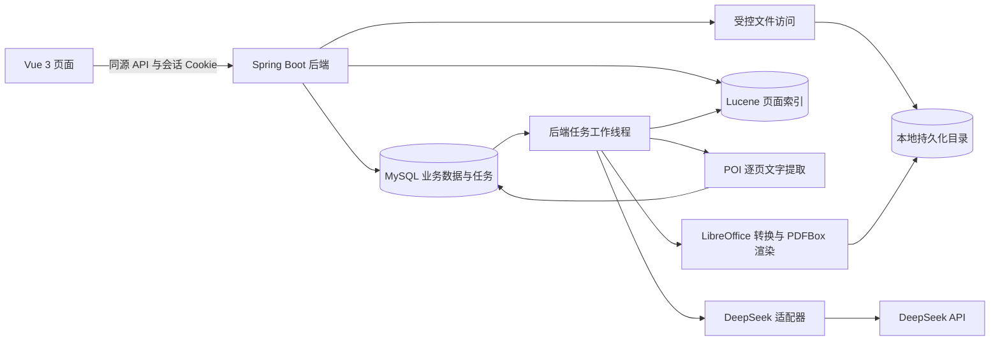

# 期末复习网站技术架构

设计基线日期：2026 年 10 月 27 日；实现更新于 10 月 28 日。v0.4.0 在现有课件与重点定位上加入阅读 AI 答疑、有限历史、可选当前页图片和持久对话。ChatWorker 使用现有 MySQL 任务表、90 秒租约和 10 秒心跳；60 秒上游请求通过异步 HTTP 每 500 毫秒检查取消；校验来源后才能发布。调度线程池调整为 3，课件、定位和答疑分别工作，外部请求不持有业务事务。详见[阅读答疑记录](records/reader-ai-20261028.md)。笔记和题库尚未实现，产品范围仍以[需求说明](requirements.md)为准。

用户已明确不使用 Docker，本地通过 Java、Node.js 与独立 MySQL 进程启动。MySQL 原选型 8.4，本轮复用已安装的 8.0.26 程序启动独立实例并通过迁移及集成测试；8.4 兼容性仍待验证。

## 1 架构选择

采用单仓库、模块化单体后端。Vue 前端负责交互，Java 后端负责身份、业务、文件访问、处理任务、检索和 DeepSeek 调用。MySQL 保存业务事实，本地文件目录保存原件与预览，Lucene 保存可重建的检索索引。

第一版只部署一个后端实例及其工作线程，不引入微服务、Redis、消息中间件或向量数据库。数据库任务队列保证重启后能识别待处理工作；这不意味着外部转换或 AI 请求具有严格的一次执行保证。

图中线程和适配器均属于同一个 Java 后端，LibreOffice 是按任务启动的外部进程。文件目录和索引目录不作为无需鉴权的静态目录暴露。

## 2 技术基线

以下为本项目的选型，依赖补丁版本在工程初始化时固定并记录；不自动升级到不兼容的最新主版本。

| 部分 | 设计选择 | 使用边界与依据 |
| --- | --- | --- |
| 前端 | Vue 3、TypeScript、Vue Router、Pinia、Vite | 工程工具按[Vue 官方快速开始](https://vuejs.org/guide/quick-start.html)初始化；Node 版本按实际工具要求校验 |
| 后端 | Java 17、Spring Boot 3.5.x、Spring MVC | [Spring Boot 3.5 系统要求](https://docs.spring.io/spring-boot/3.5/system-requirements.html)列出 Java 17 与 Maven 3.6.3 以上要求；工程计划使用 Maven Wrapper 3.9.x |
| 身份 | Spring Security 6.5 系列与服务端会话 | 由 Boot 兼容依赖管理控制，不独立升级到其他主版本 |
| 持久化 | MySQL 8.4、MyBatis Starter 3.0 系列、Flyway | [MyBatis 兼容表](https://mybatis.org/spring-boot-starter/mybatis-spring-boot-autoconfigure/)对应 Boot 3.2 至 3.5；迁移在实现阶段生成 |
| 文字处理 | Apache POI 5.x | PPTX 使用逐页对象模型；[POI 提取说明](https://poi.apache.org/text-extraction.html)支持 PPT 与 PPTX 文本提取，不据此承诺图像或所有公式可识别 |
| 静态预览 | LibreOffice headless、PDFBox 3.x | 字体、版式和页序经过样本验证后再确定支持范围 |
| 检索 | Lucene 9.12.3 与 SmartChineseAnalyzer | 固定该兼容线；其[运行要求](https://lucene.apache.org/core/9_12_3/SYSTEM_REQUIREMENTS.html)适配 Java 17，[分析器](https://lucene.apache.org/core/9_12_3/analysis/smartcn/org/apache/lucene/analysis/cn/smart/SmartChineseAnalyzer.html)用于中英文混合文本 |
| AI 接入 | 后端 HTTP 客户端与独立 DeepSeekClient | 直接封装官方接口，首期不增加 Spring AI 抽象层 |

此前只读检查曾发现 Java 命令、编译器和 Maven 运行时不一致。初始化前执行 TV01，统一工程实际使用的 JDK 和构建器；本次设计不修改全局环境变量，也不将旧检查当成当前环境已通过的证明。

## 3 模块与职责

| 模块 | 责任 | 主要数据与接口 |
| --- | --- | --- |
| auth | 注册、会话、密码校验、CSRF、用户身份 | 用户、`/api/auth` |
| course | 课程及生命周期，提供访问归属检查 | 课程、`/api/courses` |
| material | 上传、逐页内容、阅读位置与删除 | 文件、课件、页面、`/api/materials` |
| focus | 重点清单、候选关联、人工校正与掌握状态 | 重点及页面关联、`/api/focuses` |
| search | 索引更新、查询、过滤与结果排序 | Lucene 与数据库回查 |
| job | 任务创建、领取、租约、重试及执行记录 | 任务、执行尝试、`/api/jobs` |
| ai | 限制调用规模、构造提示、校验输出、记录用量 | DeepSeekClient、AI 调用记录 |
| storage | 受控路径、资产状态、下载和物理清理 | 文件资产、`/api/assets` |
| common | 统一错误、时间、请求追踪和幂等工具 | 共用 DTO 和协议 |

后端按业务模块组织，每个模块再划分 controller、service、repository 或 mapper、model。Controller 不直接运行转换进程或拼接 AI 提示词，Service 不依赖前端 DTO 的显示逻辑。不为每张表机械创建多个接口层。

前端按 auth、courses、materials、focuses 组织功能目录；api 封装会话与 CSRF，stores 管理登录与跨页面状态。上传进度、处理状态和未保存表单分别管理，后端成功响应才作为正式持久化成功。

## 4 身份与访问契约

使用 HttpOnly 会话 Cookie，HTTPS 部署启用 Secure，SameSite 采用 Lax。同源部署；开发时由 Vite 代理 `/api`，不开放任意带凭据的跨域访问。初期会话可驻内存，后端重启后重新登录；学习数据保存在 MySQL，不因会话重启丢失。

前端启动时获取 `/api/auth/csrf`，写请求通过该响应指定的请求头发送 token，登录和退出后重新获取。文件上传同样带 CSRF 请求头。此设计采用 Spring Security 文档中的[独立 CSRF 端点模式](https://docs.spring.io/spring-security/reference/6.5/servlet/exploits/csrf.html)，实现时保留与所用版本匹配的请求处理器。

JSON 登录必须执行会话固定攻击防护、CSRF 令牌更新和 SecurityContext 持久化，不能只设置当前线程身份；依据[会话持久化说明](https://docs.spring.io/spring-security/reference/6.5/servlet/authentication/session-management.html)实现并测试下一次请求恢复身份。密码只保存单向哈希，具体编码器与输入字节限制在初始化时一并固定。

所有资源访问均追溯至当前用户及所属课程。外部请求的 ownerId、文件路径和模型返回的资源 ID 不能覆盖服务端归属。对不存在或非本人资源统一返回 404；未登录返回 401，CSRF 拒绝返回 403。前端路由守卫仅辅助交互，不承担实际授权。

## 5 数据与来源标识

- 业务标识由后端生成 UUID，并以字符串传给前端；不以课程名、文件名或数组下标作为主键。
- 页面以原 PPT 页序从 1 开始编号，`slideId` 稳定不变；转换 PDF 页号是另一字段，不混用。
- 原课件不原地替换，原始内容版本保持独立。提取、预览和索引的处理修订记录分别更新。
- MySQL 是事实来源，Lucene 只能提供候选，返回前重新检查课程、课件和页面的可用状态。
- 后续笔记、题目与对话引用保存稳定来源标识和必要摘要；删除课件后保留摘要但不允许继续下载原件。

字段、约束和删除规则见[数据库设计](database-design.md)。

## 6 上传与后台边界

上传请求仅完成校验、原件落盘、课件和初始任务登记，返回 202。请求线程不等待全课件转换。临时文件使用服务端生成的路径，落盘后再完成短事务；失败后清理临时文件与未关联资产。

后端工作线程扫描数据库队列，用带条件的原子更新领取任务，写入租约令牌和过期时间。工作期间定时续租；提交结果时校验令牌、源版本、课程及课件生命周期，丢失租约的旧工作者不得发布结果。

初始建议后台并行任务数 2，其中转换进程并发数 1；实际超时和资源上限由 TV02 验证后配置。转换和网络调用在数据库事务外执行；发布结果使用短事务，避免长时间锁住业务表。

调用可以重复发生，结果发布必须幂等。任务尝试次数初值上限为 3，包含初次；超时和付费 AI 请求不盲目自动重发，无法确认外部结果时保留不确定状态与用量记录，供受控重试。

完整阶段状态、重试与文件清理见[课件处理流程](material-pipeline.md)。

## 7 重点定位流程

1. 验证重点属于当前用户课程，固定其正文修订、可检索课件范围及文字和索引修订。
2. 以原始文本和确定性分词检索当前课程，按页面返回最多 20 个候选；没有可用索引时区分未就绪与确实无匹配。
3. AI 可生成有限同义词或对候选重排，但不能自由选择数据库中的其他页面。未配置 AI 时提供明确标记的关键词候选。
4. 向模型发送经过裁剪的片段和允许的 slideId 集合，要求 JSON 返回至多 5 个候选及依据；校验 ID、文本长度、重复项和权限。
5. 再检查重点修订、课程、课件状态及引用文字修订。过期任务停止发布；候选以幂等方式更新，保留确认、排除和手动关联。部分课件未就绪时说明检索范围，全部未就绪不冒充无匹配。
6. 显示真实来源与依据，不把 Lucene 分数或 AI 排序转换为未经验证的可信度百分比。

检索不要求整门课程发送给 AI。文本不存在的图表知识不伪称可以匹配，当前页图片答疑属于 PB21，另做能力验证。

## 8 DeepSeek 接入约定

官方当前示例使用 `https://api.deepseek.com/chat/completions`，模型配置候选为 `deepseek-flash`；这些属于 2026 年 10 月 27 日核对结果，初始化时再次确认账号可用性，禁止前端硬编码 Key 或直接调用。[官方首个请求](https://api-docs.deepseek.com/)

首轮重点拆分和重排使用非流式结构化输出，设置 `response_format` 为 `json_object`，提示词包含 JSON 格式与示例，并限制输出。空响应、截断和结构不符均作为未成功，不直接写入业务表；JSON 合法并不能证明语义正确。[JSON 输出说明](https://api-docs.deepseek.com/guides/json_mode/)

thinking、输出上限和超时作为明确配置，不依赖供应商默认值；首轮短任务计划关闭 thinking，具体参数组合在 TV05 验证。流式对话留给 PB09，网关仅传回答与经核验引用，不透传内部推理内容。[请求参数](https://api-docs.deepseek.com/api/create-chat-completion/)

AI 输入中的课程材料均视为内容，不赋予其修改权限、执行命令或选择任意 URL 的能力。日志保存调用场景、模型、提示词版本、耗时、实际用量或未知状态；默认不保存完整课件正文与带凭据的请求头。

## 9 配置与运行数据

以下仅为将来的配置契约，不生成真实 `.env` 或凭据文件：

| 配置 | 含义 |
| --- | --- |
| `DB_URL`、`DB_USERNAME`、`DB_PASSWORD` | 本地或部署环境数据库连接 |
| `APP_STORAGE_ROOT` | 原件、预览、临时任务和待清理文件的绝对根目录 |
| `APP_INDEX_ROOT` | 可重建的 Lucene 目录，单实例持有写锁 |
| `LIBREOFFICE_EXECUTABLE` | 经验证的转换程序绝对路径 |
| `DEEPSEEK_API_KEY`、`DEEPSEEK_BASE_URL`、`DEEPSEEK_MODEL` | 后端外部调用配置 |
| `AI_ENABLED`、`AI_DAILY_REQUEST_LIMIT` | 能力开关及配额，未明确额度时默认不开放付费调用 |
| 上传、解压、任务超时与并发配置 | 工程初始化时固定名称和可验证初值 |

文件与数据库联合备份，索引无需作为唯一副本备份。恢复时先恢复原件和业务数据，再重建索引，并核对预览资产。没有配置 AI 时仍可使用账号、课程、阅读、手工重点和基础关键词定位。

## 10 验证与后续阶段

TV01 至 TV05 的步骤见[技术验证计划](technical-validation.md)。使用模拟 AI 验证权限、JSON 错误、重试和幂等，再用小样本进行实际调用。技术设计阶段仅核对官方资料；随后已完成一次[基础连接测试](records/deepseek-connectivity-20261027.md)，不将单次连接成功写成完整业务接入或故障验证通过。

Sprint 2 在同一架构中增加笔记、统一题库、题目版本与作答快照、对话及引用。三种习题来源共用题库与任务能力；本轮不提前创建这些表或对外承诺尚未设计的接口。
